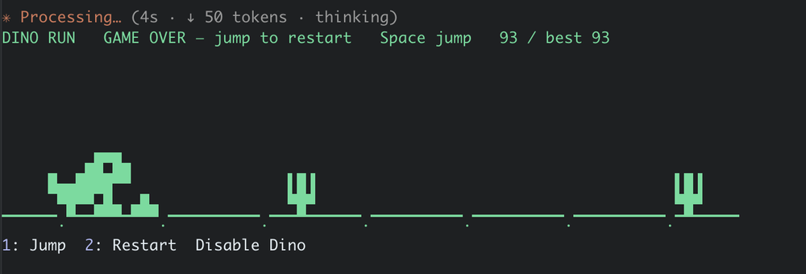
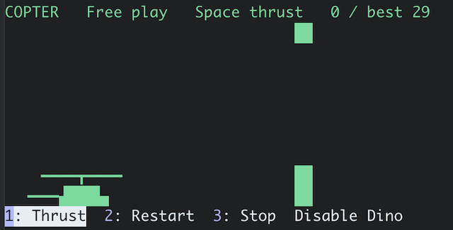

# Agent Dino

Mini-games inside Claude Code. Install once, start `claude` normally, and a game
plays right above the prompt while Claude works, including auto mode. Press
**Space** to play; no clicking, no split screen, and **no tokens used**. No
launcher, Python environment, or shell wrapper is required.



## Install

Requires Claude Code **2.1.292 or newer**, with native mods enabled. In your shell:

```sh
claude plugin install agent-dino --marketplace vijaytembugade/agent-dino
```

Or as two steps (any version from 2.1.287):

```sh
claude plugin marketplace add vijaytembugade/agent-dino
claude plugin install agent-dino@vijaytembugade
```

Or from inside a Claude Code session (2.1.275 or newer):

```
/plugin install agent-dino --marketplace vijaytembugade/agent-dino
```

Then run `/reload-plugins`, or restart Claude. You should see `Agent Dino ON` above
the prompt. Run `/dino on` to pick a game, then send any prompt to play while
Claude works, or use `/dino play` to try it now.

### Updates

```sh
claude plugin update agent-dino@vijaytembugade
```

To get new versions automatically, turn on auto-update for the `vijaytembugade`
marketplace in `/plugin` → **Marketplaces**.

### Uninstall

**Just want it out of the way?** Run `/dino off` inside Claude. The game stops at
once and stays off, but the plugin remains installed for later (`/dino on`).

**Remove it completely**, in your shell:

```sh
claude plugin uninstall agent-dino@vijaytembugade
claude plugin marketplace remove vijaytembugade   # optional: also forget the marketplace
```

Or run `/plugin` inside a Claude Code session and uninstall it from there.

Then run `/reload-plugins`, or restart Claude. The game and the `/dino` commands
are gone. Agent Dino never writes to your projects, changes your shell, or leaves
a process running; its only data is three small settings (`enabled`, `game`,
`split`) inside Claude Code's own plugin storage.

If you installed an early version from a local checkout, remove that copy too:

```sh
claude plugin uninstall agent-dino@agent-dino-local
claude plugin marketplace remove agent-dino-local
```

If you used the old Python shell integration, also run
`./agent-dino uninstall-default` once from that checkout (see [LEGACY.md](LEGACY.md)).

## Games

Run `/dino on` and press a game's number to pick it. Your pick stays until `/dino off`.

| Game | Pick with | How to play |
| --- | --- | --- |
| **Dino Run** | `/dino on dino` | **Space** jumps. Jump the cacti and the low birds; stay on the ground for the high ones. It speeds up as you go. |
| **Copter** | `/dino on copter` | **Hold Space** to climb, let go to sink. Fly through the gaps in the walls. It hovers until your first press. |



Want another game? [Add one](#adding-a-game): it is one file.

## Controls inside Claude

| Command | Action |
| --- | --- |
| `/dino on` | Lists the games above the prompt; press its number to pick. Saved until `/dino off` |
| `/dino on <game>` | Pick a game directly, e.g. `/dino on dino` |
| `/dino off` | Disable immediately and forget the pick; the next `/dino on` asks again |
| `/dino play` | Play now, without waiting for Claude (again to stop) |
| `/dino split` | Play in a separate split pane instead; `/dino split off` goes back |
| `/dino status` | Show the saved setting and current activity |
| `/enable-dino`, `/disable-dino` | Shortcuts for on/off |

`/agent-dino` is an alias for `/dino`. You can also type **enable dino**,
**disable dino**, **enable agent-dino**, or **disable agent-dino** as an ordinary
prompt. These exact controls run locally without a model call. Prompts that merely
mention the controls are sent to Claude normally.

The game plays right above the prompt while Claude works. Press **Space** to jump
(it also restarts after a crash) — no clicking needed: Space in an empty prompt goes
to the game, and anything else you type goes to the prompt as usual. **1** jumps and
**2** restarts too; in `/dino play`, **3** stops.

With `/dino split`, the game opens in its own pane instead, takes the keyboard
while Claude works (**Enter** or **j** to jump, **r** to restart, **Escape** to skip
the turn), and hands it back when Claude finishes or needs your answer.
Scores last for the current session.

**Uses no tokens.** The games run entirely on your machine. They make no model,
network, or shell calls and add nothing to the system prompt or the conversation.
`/dino` replies show as short notifications instead of transcript lines, because
Claude would read a transcript line on your next turn. Typed controls like
"enable dino" are handled locally and never sent to Claude.

The automatic game stops when Claude finishes. It pauses for permission requests
and questions, without changing their answers or permission decisions. Other
plugins' content above the prompt is preserved. It follows turn activity rather
than attempting to read private model reasoning.

## Troubleshooting

- Run `/dino status`; use `/dino on` if it was previously disabled.
- Run `/reload-plugins` after installing, or restart `claude`.
- Check `claude plugin list` for enabled `agent-dino@vijaytembugade`.
- Update Claude if native mods are unsupported. A policy disabling plugins or
  mods must be handled through your normal administrator process.
- A short terminal can leave too little space for the automatic game; enlarge
  it or use `/dino play`. A terminal of 80 columns by 24 rows is recommended.
- If you installed the old Python shell integration, run
  `./agent-dino uninstall-default` once. An existing shell can retain the old
  function until a new terminal is opened or `unfunction claude` is run in zsh.

## Adding a game

A game is **one file** in `hooks/games/` plus **one line** in
`hooks/games/index.js`. You never touch Claude Code's API: `hooks/register.js`
already handles the commands, the game list, Space, the timer, pausing and drawing,
for every game.

### 1. Write the game

Create `hooks/games/<id>.js`. Copy this skeleton, which is a complete, working
game (a ball you bounce over gaps), then make it yours:

```js
// hooks/games/bounce.js: pure simulation and drawing, nothing else.
export class BounceGame {
  constructor() {
    this.best = 0        // best score this session; reset() keeps it
    this.columns = 60    // frame() updates these to the space available
    this.rows = 7
    this.reset()
  }

  reset() {              // a new round
    this.y = 0           // height above the ground, in rows
    this.vy = 0
    this.distance = 0
    this.score = 0
    this.over = false    // true shows GAME OVER; action() then restarts
  }

  action() {             // Space (and the action button): this game's one control
    if (this.over) return this.reset()
    if (this.y === 0) this.vy = 12
  }

  tick(seconds) {        // called about 20 times a second while the game runs
    if (this.over) return
    this.vy -= 30 * seconds
    this.y = Math.max(0, this.y + this.vy * seconds)
    this.distance += 12 * seconds
    this.score = Math.floor(this.distance)
    this.best = Math.max(this.best, this.score)
    const hole = Math.floor(this.distance) % 30 > 26   // a gap in the ground
    if (hole && this.y === 0) this.over = true
  }

  frame(columns, rows) { // return exactly `rows` lines, each at most `columns` wide
    this.columns = columns
    this.rows = rows
    const lines = Array.from({ length: rows }, () => ' '.repeat(columns))
    const ballRow = rows - 2 - Math.min(rows - 2, Math.round(this.y))
    lines[ballRow] = '    ' + (this.over ? '✸' : '●')
    lines[rows - 1] = Array.from({ length: columns }, (_, x) =>
      (Math.floor(this.distance) + x - 4) % 30 > 26 ? ' ' : '▔').join('')
    return lines.join('\n')
  }
}
```

What the plugin expects from every game:

| Member | What it does |
| --- | --- |
| `action()` | The single control, sent by **Space**, **1**, Enter, or the button. Restart the round when `over` is true. |
| `reset()` | Start a new round, keeping `best`. |
| `tick(seconds)` | Advance the game. `seconds` is small (about 0.05), but cap it in case of a slow frame. |
| `frame(columns, rows)` | Draw. Return `rows` lines joined by `\n`. Above the prompt you get about 4–9 rows and 20–80 columns, so it must look right at any size in that range. |
| `over`, `score`, `best` | Read by the header line: `GAME OVER`, `12 / best 40`. `score` may be a field or a getter. |

### 2. List it

Add one entry to `GAMES` in `hooks/games/index.js`:

```js
import { BounceGame } from './bounce.js'

export const GAMES = [
  // ...the existing games
  { id: 'bounce', name: 'Bounce', description: 'Hop the gaps in the ground',
    actionLabel: 'Hop', hotkey: 'h', create: () => new BounceGame() },
]
```

`id` is what people type in `/dino on bounce`. `actionLabel` names the button.
`hotkey` is one lowercase letter, used in the split pane.

### 3. Try it

Start Claude Code with your clone loaded for that session (it takes the place of
an installed copy, so you see your changes):

```sh
claude --plugin-dir .
```

Then run `/dino on bounce` and `/dino play`. After editing, run `/reload-plugins`.
To iterate faster, render frames straight from Node:

```sh
node --input-type=module -e "
import { BounceGame } from './hooks/games/bounce.js'
const g = new BounceGame(); g.action(); g.tick(0.2)
console.log(g.frame(60, 7))"
```

### 4. Bump the version

Raise `version` in both `plugin.json` and `.claude-plugin/plugin.json`
(`1.4.0` → `1.5.0` for a new game, `1.4.1` for a fix). Users only get your change
when the version goes up, so a PR that changes `hooks/` without a bump fails its check.

### 5. Test it and open a pull request

Add a test to `native-tests/dino.test.ts` proving the game is **fair**: every
obstacle can be cleared. See the Dino Run and Copter tests there, which fly an
autopilot through hundreds of runs. Then run the full check:

```sh
git config core.hooksPath .githooks   # once: runs the check before every push
node scripts/security-check.mjs       # security rules + plugin validate + tests
```

### Rules for games

These are enforced by the security check, on your machine and on every pull request:

- **Pure:** a game only computes and returns text. No `$`, no Claude Code API, no
  files, network, processes, timers, `eval`, or imports from outside `hooks/games/`.
- **One control:** everything is played with a single action, so it works with
  Space above the prompt and with a button in the split pane.
- **Cheap:** `tick()` and `frame()` run 20 times a second while someone is working.
  Keep loops bounded and the output exactly the size asked for.
- **Fair:** speed can grow, but every obstacle must stay clearable; prove it in a test.
- **Original art:** draw your own sprites with Unicode block and box characters.

## Security

Read [SECURITY.md](SECURITY.md) before contributing. Every PR is checked against it
automatically; run the same check locally with `git config core.hooksPath .githooks`
(once), or `node scripts/security-check.mjs`.

## Development

```sh
claude plugin validate --strict .
claude plugin test .
```

`hooks/register.js` implements native commands, lifecycle handling, UI, and the
saved setting. Games live in `hooks/games/`: `dino.js` is Dino Run, `copter.js` is Copter, and
`index.js` is the catalog the `/dino on` list is built from. `native-tests/dino.test.ts`
tests the actual mod using Claude's test runner, without an AI account or network. No npm dependencies are required.
The native game makes no network, shell, or model calls.

Claude native plugin version: **1.4.0**. The older Python adapter remains at
**0.2.3** and is documented separately in [LEGACY.md](LEGACY.md). Codex support
currently uses that optional legacy adapter; this native UI implementation is
for Claude Code.

[Claude mods documentation](https://code.claude.com/docs/en/plugins/mods/overview).
Original ASCII artwork inspired by Chrome's offline game. MIT licensed.
Not affiliated with Google, Anthropic, or OpenAI.
